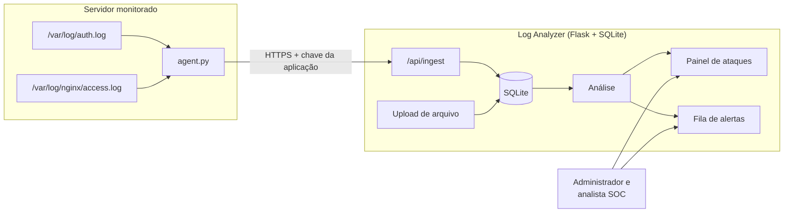
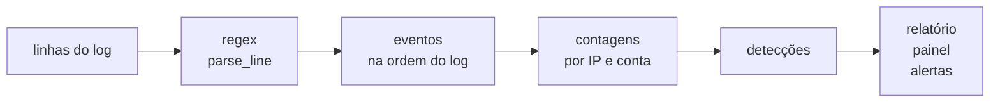
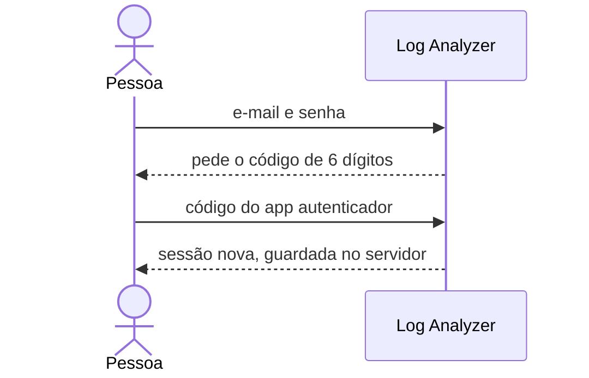
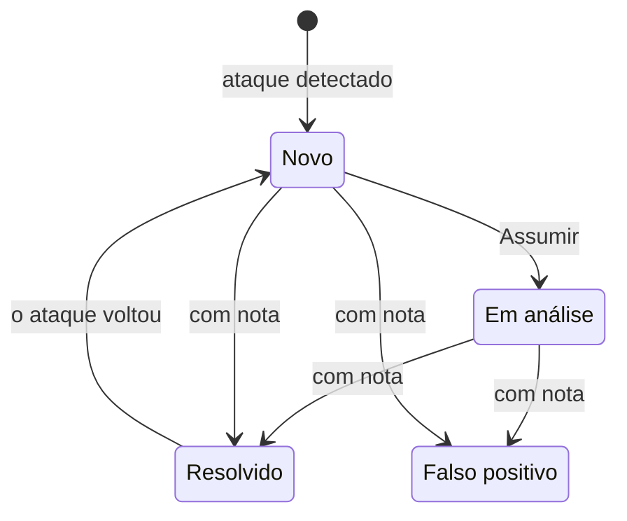

# Log Analyzer

**Detector de ataques em logs SSH e web, com painel, triagem de alertas para SOC e login seguro.**


Lê os logs de um servidor Linux (`auth.log`) ou de um site (`access.log` do nginx/Apache) e responde às perguntas que importam numa investigação:

1. **Alguém está atacando?** Brute force, SQL injection, varreduras, execução de comandos...
2. **O que está sendo atacado?** Contas, páginas, arquivos.
3. **Algum atacante conseguiu entrar?** É a pergunta mais importante.
4. **Como corrigir?** Passos e configurações prontas para cada ataque encontrado.

**▶ Veja funcionando, sem instalar nada:** [painel de um servidor SSH](https://aurelioalmeidab.github.io/log-analyzer/dashboard.html) · [painel de um site com nginx](https://aurelioalmeidab.github.io/log-analyzer/dashboard_web.html)

---

## Sumário

- [Dois jeitos de usar](#dois-jeitos-de-usar)
- [Começo rápido](#começo-rápido)
- [Como funciona](#como-funciona)
- [O que é detectado](#o-que-é-detectado)
- [Linha de comando](#linha-de-comando)
- [Aplicação web](#aplicação-web)
- [Segurança](#segurança)
- [Testes](#testes)
- [Estrutura do projeto](#estrutura-do-projeto)
- [Colocar em produção](#colocar-em-produção)
- [Limitações conhecidas](#limitações-conhecidas)
- [Próximos passos](#próximos-passos)
- [Aviso](#aviso)

---

## Dois jeitos de usar

| | Linha de comando | Aplicação web |
|---|---|---|
| **Para quê** | Analisar um arquivo de log agora | Monitorar vários servidores e sites o tempo todo, em equipe |
| **Como** | `python log_analyzer.py arquivo.log` | Navegador, com login e 2FA |
| **Resultado** | Relatório no terminal e painel HTML que abre offline | Painel por aplicação, fila de alertas, histórico |
| **Instalação** | Nenhuma: só Python | Flask (`pip install -r requirements.txt`) |

---

## Começo rápido

### Analisar um log em 10 segundos

```bash
git clone https://github.com/AurelioAlmeidaB/log-analyzer.git
cd log-analyzer
python3 log_analyzer.py sample_auth.log --html painel.html
```

```
=== RELATÓRIO DE ANÁLISE DE LOG ===
Eventos de login: 23  |  Falhas: 21

🚨 ALERTA: login aceito após falhas
   203.0.113.5  (12 falhas, depois sucesso como "root" em Nov 22 02:47:16)

⚠️  Possível brute force (>= 5 falhas)
   203.0.113.5      12 falhas
   198.51.100.7      7 falhas

🎯 Contas mais atacadas
   root         5
   admin        2
   maria        2
   test         1
   oracle       1
   ... (+10 contas)

📊 Dashboard salvo em painel.html
```

Abra o `painel.html` no navegador para ver o painel completo.

### Subir a aplicação web em 2 minutos

```bash
python3 -m venv .venv                     # no Ubuntu: sudo apt install python3-venv
.venv/bin/pip install -r requirements.txt
.venv/bin/flask --app webapp run
```

Abra http://127.0.0.1:5000, crie sua conta, ative o 2FA com o app autenticador do celular e:

1. Crie uma aplicação (*Servidor Linux* ou *Site/API*).
2. Envie o `sample_access.log` pela página, ou ligue o agente no servidor.
3. Abra o painel e a fila de **Alertas**.

---

## Como funciona

### Visão geral



O mesmo motor de análise atende a linha de comando e a aplicação web. Por isso o relatório no terminal e o painel nunca discordam.

### O motor de análise



Cada linha vira um evento (`{"time", "user", "ip", "status"}` no SSH; método, caminho, status e user-agent na web). As detecções percorrem os eventos **na ordem em que aconteceram**.

### Por que a ordem importa

Falhas de login acontecem o tempo todo: robôs varrem a internet testando `root/123456`. Elas mostram que você **está sendo atacado**. Um login **aceito** logo depois de várias falhas do mesmo IP mostra que o ataque **deu certo**.

```
203.0.113.5   ✕ ✕ ✕ ✕ ✕ │ ✕ ✕ ✕ ✕ ✕ ✕ ✕ ✓   12 falhas seguidas, depois entrou    → CRÍTICO
192.0.2.10    ✕ ✕ ✓                          errou a senha 2 vezes e entrou     → normal
                        └─ limite de 5 falhas
```

Uma contagem simples não distingue os dois casos; só a ordem distingue. E o contador **zera a cada login aceito**: sem isso, quem erra a senha duas vezes por dia viraria "atacante" no terceiro dia de um log longo. Esse falso positivo foi encontrado num teste com 104 mil linhas e corrigido.

---

## O que é detectado

### Servidor Linux (SSH, `auth.log`)

| Ataque | Como é reconhecido | Gravidade |
|---|---|:---:|
| Login aceito depois de brute force | login aceito após ≥ 5 falhas **seguidas** do mesmo IP | crítica |
| Brute force | IP com ≥ 5 falhas | alta |
| Várias contas testadas | ≥ 3 usuários diferentes, inclusive contas que nem existem | média |
| Varredura da porta 22 | conexões que fecham sem completar o handshake SSH | baixa |

Formatos aceitos: data clássica do syslog (`Nov 22 02:47:03`) e RFC 3339 (`2026-11-22T02:47:03.123-03:00`, padrão do Ubuntu 24.04), `sshd` e `sshd-session` (OpenSSH 9.8+), IPv4 e IPv6, e as linhas agrupadas pelo rsyslog (`message repeated 5 times: [...]`), que contam como 5 tentativas.

### Site ou API (nginx / Apache, `access.log`)

| Ataque | Exemplo do que é reconhecido | Gravidade |
|---|---|:---:|
| Arquivo sensível exposto | `GET /.env` com resposta **200** | crítica |
| Login aceito depois de brute force | `POST /wp-login.php` com sucesso após ≥ 5 erros seguidos | crítica |
| Execução de comando (RCE) | `;cat /etc/passwd`, `$(id)`, Log4Shell `${jndi:...}`, Shellshock | alta |
| SQL injection | `' OR '1'='1`, `UNION SELECT`, `SLEEP(5)` | alta |
| Path traversal | `../../etc/passwd`, inclusive com dupla codificação `%252e%252e` | alta |
| XSS | `<script>`, `onerror=`, `javascript:` | média |
| Brute force no login | ≥ 5 senhas erradas do mesmo IP no formulário de login | alta |
| Varredura | ≥ 20 respostas 404 ou ferramenta de varredura | baixa |

### Qual ferramenta o atacante usou

| Sinal no log | Ferramenta provável |
|---|---|
| Banner SSH `libssh_*` | Hydra |
| Banner SSH `libssh2_*` | Medusa ou Nmap `ssh-brute` |
| Banner SSH `Go` | bot ou scanner escrito em Go |
| Banner SSH `Nmap-SSH2-*` | Nmap |
| User-agent `sqlmap`, `Nikto`, `gobuster`, `WPScan`, `Nuclei`, `ffuf`, `(Hydra)`... | a própria ferramenta |
| User-agent com `${jndi:` ou `() { :; };` | exploit enviado no cabeçalho |
| Intervalo mediano ≤ 3 s entre tentativas | ferramenta automática (ninguém digita tão rápido) |

É uma **estimativa**: banner e user-agent podem ser falsificados. No SSH, o banner do cliente só aparece com `LogLevel DEBUG1` e a porta de destino com `LogLevel VERBOSE` no `sshd_config`.

### MITRE ATT&CK

Cada IP recebe as técnicas correspondentes, com as linhas do log que servem de evidência:

| Técnica | Quando |
|---|---|
| [T1046](https://attack.mitre.org/techniques/T1046/) Varredura de serviço | conexões SSH sem handshake |
| [T1595.002](https://attack.mitre.org/techniques/T1595/002/) Varredura de vulnerabilidades | ferramenta de varredura no user-agent |
| [T1595.003](https://attack.mitre.org/techniques/T1595/003/) Varredura por lista de palavras | muitos 404 ou procura por arquivos sensíveis |
| [T1190](https://attack.mitre.org/techniques/T1190/) Exploração de aplicação pública | SQL injection, XSS, traversal, RCE |
| [T1110.001](https://attack.mitre.org/techniques/T1110/001/) Adivinhação de senha | muitas senhas na mesma conta |
| [T1110.003](https://attack.mitre.org/techniques/T1110/003/) Password spraying | muitas contas testadas |
| [T1078](https://attack.mitre.org/techniques/T1078/) Uso de conta válida | login aceito depois de brute force |
| [T1552.001](https://attack.mitre.org/techniques/T1552/001/) Credenciais em arquivos | `.env` ou backup baixado com sucesso |

### Como corrigir

Para cada ataque encontrado, o painel mostra o que fazer, do mais grave para o menos grave, com configurações prontas para copiar. Por exemplo, para brute force no SSH:

```
# /etc/ssh/sshd_config
PasswordAuthentication no
PermitRootLogin no
MaxAuthTries 3
sudo apt install fail2ban
```

As recomendações ficam em [`remediation.py`](remediation.py): login invadido (como investigar), `.env` exposto (o que trocar), SQL injection (consulta parametrizada), path traversal, XSS, RCE, varreduras.

---

## Linha de comando

Só precisa do Python, sem bibliotecas externas. O formato do log é detectado sozinho.

```bash
python3 log_analyzer.py sample_auth.log                          # relatório SSH
python3 log_analyzer.py sample_access.log                        # relatório web
python3 log_analyzer.py sample_auth.log --html painel.html       # + painel HTML
python3 log_analyzer.py /var/log/auth.log --limite 10            # outro limite de brute force
python3 log_analyzer.py sample_auth.log --json > analise.json    # análise completa em JSON
```

| Opção | O que faz |
|---|---|
| `--html ARQUIVO` | gera o painel HTML (um arquivo só, abre offline) |
| `--tipo auto\|ssh\|web` | força o formato do log (padrão: detectar) |
| `--limite N` | falhas seguidas para considerar brute force (padrão: 5) |
| `--json` | imprime a análise completa em JSON, para integrar com outras ferramentas |

<details>
<summary>Relatório de um log web (<code>sample_access.log</code>)</summary>

```
=== RELATÓRIO DE ANÁLISE DE LOG (WEB) ===
Requisições: 63  |  Ataques: 28  |  IPs: 6

🚨 ALERTA: ataque com sucesso
   198.51.100.23   GET /.env respondeu 200 (arquivo sensível exposto)
   203.0.113.50    login aceito em /wp-login.php depois de 8 falhas (27/Nov/2026:10:05:43 -0300)

⚠️  Ataques por tipo
   SQL injection            10   (203.0.113.9)
   Senha errada no login     8   (203.0.113.50)
   Arquivo sensível          6   (198.51.100.23)
   Execução de comando       2   (203.0.113.200)
   Path traversal            1   (198.51.100.23)
   XSS                       1   (198.51.100.23)

🔎 Varredura (>= 20 respostas 404)
   198.51.100.77     24 x 404

🛠️  Ferramentas de ataque (pelo user-agent)
   203.0.113.9     sqlmap
   198.51.100.23   Nikto
   203.0.113.50    Hydra
   198.51.100.77   Gobuster

🎯 Caminhos mais atacados
   /produto.php                               10
   /wp-login.php                               8
   /.git/config                                1
   /.env                                       1
   /backup.sql                                 1
```

</details>

### O painel HTML

Um único arquivo, sem dependências, que funciona offline e no celular, nos temas claro e escuro:

- **Veredito** no topo: algum atacante entrou? Como e quando?
- **Origem dos ataques:** cada IP com risco, ferramenta provável e ritmo das tentativas.
- **Alvo:** host, porta, contas que existem e contas inventadas pelo atacante.
- **Como corrigir**, **Ferramentas e técnicas** (MITRE ATT&CK) e **Sequência de eventos por IP**, com o limite marcado.
- **Log completo** com filtros, busca e destaque. Cada evidência leva à linha certa, e o endereço `painel.html#L41` abre direto na linha 41.

Exemplos ao vivo: [SSH](https://aurelioalmeidab.github.io/log-analyzer/dashboard.html) · [web](https://aurelioalmeidab.github.io/log-analyzer/dashboard_web.html)

---

## Aplicação web

### Login seguro



- **Cadastro** com e-mail e senha: mínimo de 10 caracteres, senhas óbvias recusadas.
- **2FA obrigatório:** QR code para Google Authenticator, Microsoft Authenticator, Authy, 1Password ou Bitwarden. Ao digitar o sexto número, o código é enviado sozinho.
- **8 códigos de recuperação** de uso único, para quem perder o celular, e opção de trocar o app autenticador confirmando a senha.
- **Sessões revogáveis:** a página da conta lista onde você está conectado, com o botão "Encerrar as outras".

### Organizações e papéis

Cada conta nasce com a sua organização, e as aplicações pertencem a ela. **Quem é de outra organização não vê nada, nem descobre que a aplicação existe** (a resposta é sempre 404).

| Ação | Administrador | Analista SOC |
|---|:---:|:---:|
| Ver aplicações, painéis e logs | ✓ | ✓ |
| Baixar o relatório em JSON | ✓ | ✓ |
| Triar alertas: assumir, mudar status, escrever notas | ✓ | ✓ |
| Enviar arquivo de log | ✓ | |
| Criar e excluir aplicações, ver e trocar chaves, apagar logs | ✓ | |
| Convidar pessoas, mudar papéis, remover membros | ✓ | |
| Ver o registro de atividade (quem fez o quê) | ✓ | |

- **Convites:** o administrador gera um link de uso único, válido por 7 dias e só para o e-mail convidado.
- **Mudanças valem na hora:** mudar o papel ou remover alguém não espera a pessoa sair.
- A organização **sempre tem pelo menos um administrador**.
- O servidor confere o papel em cada ação. Esconder os botões na interface é só usabilidade, não a proteção.

### Monitorar uma aplicação

1. **Nova aplicação:** escolha *Servidor Linux (SSH)* ou *Site ou API (nginx/Apache)* e copie a chave, que aparece uma vez só.
2. **Para testar agora:** envie um arquivo de log pela página (até 10 MB). Reenviar o mesmo arquivo não duplica linhas.
3. **Para monitorar sempre:** rode o agente no servidor:

```bash
curl -fsSO https://seu-log-analyzer/agent.py
export LA_CHAVE="la_..."
python3 agent.py --servidor https://seu-log-analyzer --arquivo /var/log/auth.log
```

O agente (`agent.py`) usa só a biblioteca padrão e:
- envia as linhas novas a cada 5 segundos;
- continua de onde parou depois de reiniciar, sem duplicar nem perder linhas;
- percebe rotação de log (logrotate);
- tenta de novo, com espera crescente, se o servidor cair;
- recusa redirecionamentos, para nunca entregar a chave a outro servidor.

| Opção do agente | O que faz |
|---|---|
| `--servidor URL` | endereço do Log Analyzer |
| `--arquivo CAMINHO` | log a monitorar |
| `--chave` | chave da aplicação (prefira a variável `LA_CHAVE`: um argumento aparece em `ps`) |
| `--intervalo S` | segundos entre verificações (padrão: 5) |
| `--uma-vez` | envia o que houver de novo e sai |
| `--do-fim` | na primeira execução, ignora o conteúdo antigo |

### Triagem de alertas

Cada tipo de ataque vindo de um IP vira um **alerta**, como *"Brute force no SSH — 203.0.113.5"*. A página **Alertas** é a fila de trabalho do SOC, e o menu mostra quantos alertas são novos.



- **Fechar exige uma nota** dizendo o que foi visto e feito, para quem investigar depois.
- **Reabre sozinho:** um alerta resolvido volta para *Novo* se o ataque acontecer de novo depois da decisão. Um falso positivo continua fechado; só os números são atualizados.
- **Cada alerta mostra:**
  - as linhas do log que são a evidência, com link para a linha no painel;
  - como corrigir;
  - o histórico completo: quem assumiu, quem mudou o status e as notas.
- **Filas por status**, com filtros de gravidade, aplicação e "só os meus", ordenadas da mais grave para a menos grave.
- **No painel de ataques,** cada IP mostra o status da triagem e leva ao alerta.

---

## Segurança

Uma ferramenta de segurança precisa ser segura. Proteções implementadas:

| Área | Proteção |
|---|---|
| Senhas | hash **scrypt**; nunca guardadas em texto |
| 2FA | TOTP (RFC 6238), validado com os vetores oficiais; tolera ±30 s; o mesmo código não serve duas vezes |
| Códigos de recuperação | uso único, guardados com **HMAC** e a chave do servidor: quem copia só o banco não consegue testá-los |
| Brute force no próprio login | 5 senhas erradas por conta ou 20 por IP em 15 min bloqueiam; 5 códigos 2FA errados por conta em 15 min; 10 tentativas de cadastro por IP por hora |
| Enumeração de contas | mesma mensagem e mesmo tempo de resposta para "e-mail não existe" e "senha errada" |
| Sessões | guardadas no servidor; sair, trocar a senha ou "encerrar as outras" revoga de verdade; terminam após 2 h sem uso ou 12 h no total |
| Cookie | `HttpOnly`, `SameSite=Lax`, `Secure` com HTTPS; sessão nova a cada login (contra fixação) |
| CSRF | token em todo formulário |
| XSS | escape automático nos templates; **CSP com nonce**, sem `unsafe-inline`; o texto do log, que vem do atacante, nunca vira HTML |
| Clickjacking e afins | `frame-ancestors 'none'`, `X-Frame-Options`, `nosniff`, HSTS com HTTPS |
| Isolamento entre organizações | toda consulta junta o recurso com a participação da pessoa; o papel é conferido no servidor |
| Chaves de API e convites | gerados com `secrets`, guardados só como hash, mostrados uma vez |
| Redirecionamento aberto | `?next=` só aceita caminhos do próprio site, inclusive contra `/\site.com` |
| ReDoS | nenhuma regex tem repetição ambígua; uma linha hostil de 64 KB é analisada em milissegundos |
| Arquivo do banco | permissão `600`: outros usuários da máquina não leem |
| Agente | não segue redirecionamentos (o `urllib` repassaria a chave ao novo endereço) |

### Revisão de segurança

A própria aplicação foi atacada durante o desenvolvimento. Estas falhas foram encontradas, corrigidas e ganharam teste em [`tests/test_security.py`](tests/test_security.py):

| Gravidade | Falha encontrada | Correção |
|---|---|---|
| Alta | **ReDoS:** um único pedido com `union/**/ /**/ ...` no endereço travava a análise por mais de 10 s | padrão de comentário SQL sem ambiguidade |
| Alta | O agente **entregava a chave de API** ao seguir um redirecionamento 301/302/303 para outro servidor | o agente recusa redirecionamentos |
| Média | Sair da conta não invalidava o cookie: uma cópia dele continuava valendo por 8 h | sessões guardadas e revogadas no servidor |
| Média | Trocar a senha não derrubava as sessões abertas em outros navegadores | a troca encerra todas as outras |
| Média | `?next=/\site.com` mandava a pessoa para outro site depois do login | validação recusa a barra invertida |
| Média | O limite do cadastro só contava os cadastros que deram certo, permitindo testar e-mails sem limite | toda tentativa conta |
| Média | Códigos de recuperação em SHA-256 puro (~49 bits) podiam ser quebrados a partir de uma cópia do banco | HMAC com a chave do servidor |
| Baixa | Banco criado com permissão `644` | permissão `600` |
| Baixa | Regex do banner SSH com custo quadrático | padrão linear |

---

## Testes

```bash
python3 -m unittest -v                 # analisador, agente e 2FA: sem dependências
.venv/bin/python -m unittest -v        # tudo, inclusive a aplicação web
```

**158 testes:**

| Arquivo | Testes | O que cobre |
|---|:---:|---|
| `test_log_analyzer.py` | 42 | regex, ordem do log, contador que zera, relatório, CLI, IPv6, limite de tamanho do painel |
| `test_web_log_analyzer.py` | 20 | assinaturas de ataque, login de formulário e de API, ferramentas, falsos positivos |
| `test_agent.py` | 7 | linhas novas, linha incompleta, rotação, lotes, chave inválida, recusa de redirecionamento |
| `test_totp.py` | 7 | vetores oficiais do RFC 6238, reuso de código, códigos de recuperação |
| `test_webapp.py` | 25 | cadastro, 2FA, login, upload, API do agente, cabeçalhos de segurança |
| `test_security.py` | 36 | isolamento entre organizações, papéis, convites, sessões, ReDoS, migração do banco |
| `test_triage.py` | 21 | criação dos alertas, fluxo de triagem, reabertura, filtros, permissões |

Alguns que contam a história do projeto:

- `test_order_matters`: um sucesso **antes** das falhas não é invasão.
- `test_legit_user_is_not_flagged_after_many_days`: a usuária que erra a senha não vira atacante num log longo.
- `test_other_org_gets_404_on_every_page`: o usuário X não acessa nada do usuário Y.
- `test_analyst_cannot_change_apps`: o analista SOC recebe 403 e nada muda no banco.
- `test_html_escapes_attacker_controlled_text`: um usuário chamado `</script><script>...` no log não executa código no painel.
- `test_resolved_alert_reopens_when_attack_returns`: o ciclo de vida da triagem.

### Logs de exemplo

Todos usam IPs reservados para documentação (RFC 5737), que não pertencem a ninguém.

<details>
<summary><code>sample_auth.log</code>: 4 cenários SSH</summary>

| IP | O que acontece | Resultado |
|---|---|---|
| 203.0.113.5 | Hydra: 12 senhas erradas e entra como `root` | **crítico** |
| 198.51.100.7 | bot em Go: varre a porta e tenta 7 contas | alto |
| 203.0.113.88 | Nmap: só varredura | médio |
| 192.0.2.10 | `maria` erra a senha duas vezes e entra | baixo, não é suspeito |

</details>

<details>
<summary><code>sample_access.log</code>: 6 cenários web</summary>

| IP | O que acontece | Resultado |
|---|---|---|
| 198.51.100.23 | Nikto acha o `.env` exposto | **crítico** |
| 203.0.113.50 | Hydra no `/wp-login.php`: 8 erros e entra | **crítico** |
| 203.0.113.9 | sqlmap com 10 payloads de SQL injection | alto |
| 203.0.113.200 | Log4Shell e Shellshock no user-agent | alto |
| 198.51.100.77 | Gobuster: 24 páginas inexistentes | médio |
| 192.0.2.44 | visitante normal | baixo |

</details>

---

## Estrutura do projeto

```
log_analyzer.py           CLI e regras do SSH: parse_line → eventos → contagens → detecções → relatório
web_log_analyzer.py       regras do nginx/Apache: assinaturas, login, ferramenta pelo user-agent
remediation.py            como corrigir cada tipo de ataque
dashboard.py              monta os dados do painel (SSH e web) e gera o HTML
dashboard_template.html   o painel: HTML, CSS e JS sem dependências
agent.py                  agente que envia o log para a aplicação web
webapp/
  __init__.py             cria a aplicação Flask e a configuração
  auth.py                 cadastro, 2FA, códigos de recuperação, sessões, conta
  team.py                 organizações, convites, papéis, registro de atividade
  monitor.py              aplicações, upload, API do agente, painel e relatório
  alerts.py               triagem: fila, status, responsável, notas e histórico
  analysis.py             análise das linhas guardadas e sincronização dos alertas
  security.py             CSRF, CSP, limites de tentativa, sessões, permissões
  db.py                   esquema e migrações do SQLite
  totp.py                 2FA (RFC 6238) só com a biblioteca padrão
  templates/, static/     páginas
tests/                    158 testes (unittest)
sample_auth.log           log SSH de exemplo
sample_access.log         log nginx de exemplo
```

**Decisões de projeto:**

- **O analisador não tem dependências.** Ele roda em qualquer servidor com Python, inclusive onde não dá para instalar pacotes; só a aplicação web usa Flask.
- **O banco evolui por migrações** (`PRAGMA user_version`). Um banco de versão antiga é atualizado sozinho, sem perder dados.
- **A análise vira um dicionário pronto para exibir**, e o template só desenha. A linha de comando e a aplicação usam o mesmo template.

---

## Colocar em produção

`flask run` é só para desenvolvimento. Em produção, use HTTPS e um servidor WSGI:

```bash
.venv/bin/pip install gunicorn
export LA_SECRET_KEY="$(python3 -c 'import secrets; print(secrets.token_hex(32))')"
LA_HTTPS=1 LA_BEHIND_PROXY=1 .venv/bin/gunicorn -w 2 -b 127.0.0.1:8000 "webapp:create_app()"
```

Coloque o nginx na frente, com certificado do Let's Encrypt.

| Variável | Para quê |
|---|---|
| `LA_SECRET_KEY` | chave das sessões e dos códigos de recuperação; sem ela, uma é gerada em `instance/secret_key`. Trocar a chave invalida sessões e códigos |
| `LA_DATABASE` | caminho do banco (padrão: `instance/log_analyzer.db`) |
| `LA_HTTPS=1` | cookie `Secure` e HSTS |
| `LA_BEHIND_PROXY=1` | confia no `X-Forwarded-For` do nginx para saber o IP real (necessário para o limite de tentativas) |
| `LA_ALLOW_SIGNUP=0` | fecha o cadastro de novas contas; daí em diante, entra-se por convite |

O GitHub Pages só hospeda os painéis estáticos. A aplicação web precisa de um servidor: uma VPS, Render, Railway, Fly.io etc.

---

## Limitações conhecidas

- **A detecção é por assinaturas e heurísticas:** um atacante cuidadoso pode disfarçar o payload, e um texto inocente pode parecer ataque. A triagem existe para isso: o analista confirma ou marca como falso positivo.
- **O formato clássico do syslog não tem ano.** Logs que atravessam a virada do ano podem ter intervalos calculados errado.
- **A análise é refeita a cada abertura do painel.** Com 200 mil linhas por aplicação, isso leva alguns segundos.
- **Não há envio de e-mail.** O link de convite é copiado e enviado pelo administrador, e não existe recuperação de senha por e-mail.
- **O segredo do 2FA fica em texto no banco.** Quem tiver o banco *e* a senha de alguém consegue entrar; criptografá-lo exigiria uma biblioteca a mais.
- **Varreduras geram muitos alertas de gravidade baixa** num servidor exposto à internet.
- **O SQLite atende bem equipes pequenas;** para muitos servidores enviando logs ao mesmo tempo, o próximo passo é PostgreSQL.

---

## Próximos passos

- [ ] Notificação por e-mail ou Telegram quando surgir um alerta crítico
- [ ] Fechar sozinhos (ou agrupar) os alertas de gravidade baixa
- [ ] Prazo de atendimento por gravidade (SLA) na fila de alertas
- [ ] Falhas em janela de tempo: 5 falhas em 1 minuto pesam mais que 5 em um dia
- [ ] Análise em segundo plano para logs grandes
- [ ] Recuperação de senha e convites por e-mail; passkeys (WebAuthn) como alternativa ao código
- [ ] Mandar só o resumo agregado (nunca o log cru) para um LLM explicar o incidente em português

---

## Aviso

Use apenas em logs seus ou de laboratório. As ferramentas de ataque citadas (Hydra, sqlmap, Nikto...) aparecem só como **assinaturas para reconhecer** nos logs; este projeto não ataca nada.
